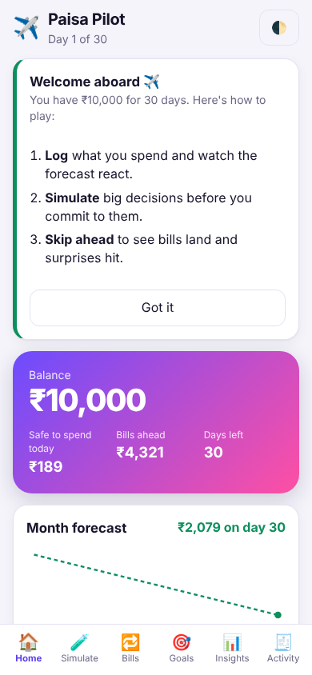
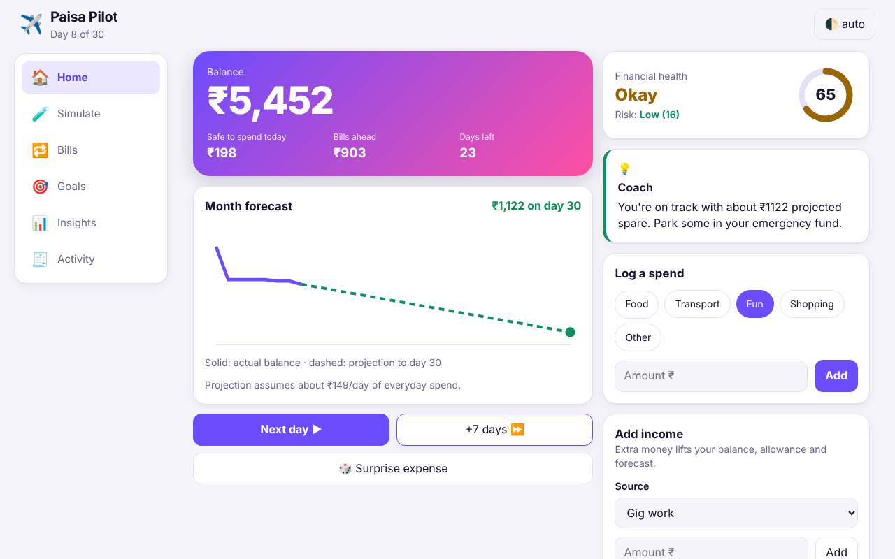
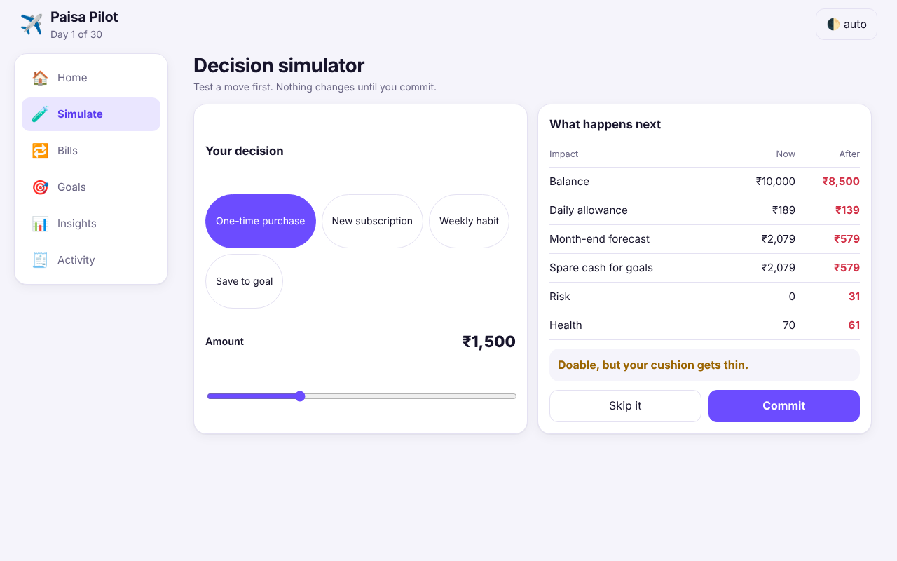
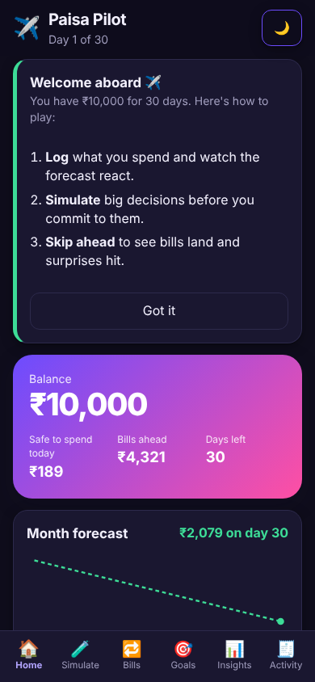

# ✈️ Paisa Pilot: Survive the Month on ₹10,000


A frontend-only personal finance simulator for Gen Z. You get a ₹10,000 budget for 30 days. Every decision (a purchase, a subscription, a new habit, a savings top-up, an unexpected bill) visibly changes your **balance, daily allowance, goals, month forecast, risk and financial health**, and you can **preview any decision before committing** to it.

Problem statement: _Broke But Functional — Survive the Month_.

|                                        Mobile                                         |                                         Desktop                                          |
| :-----------------------------------------------------------------------------------: | :--------------------------------------------------------------------------------------: |
|  |  |

|                                        Simulator                                        |                                         Dark mode                                         |
| :-------------------------------------------------------------------------------------: | :---------------------------------------------------------------------------------------: |
|  |  |

## Table of contents

- [Features](#features)
- [How the numbers connect](#how-the-numbers-connect)
- [Tech stack](#tech-stack)
- [Getting started](#getting-started)
- [Scripts](#scripts)
- [Project structure](#project-structure)
- [Quality checklist](#quality-checklist)
- [Deploy](#deploy)
- [Troubleshooting & FAQ](#troubleshooting--faq)
- [More documentation](#more-documentation)
- [License](#license)

## Features

| Area                      | What it does                                                                                                                                                                                  |
| ------------------------- | --------------------------------------------------------------------------------------------------------------------------------------------------------------------------------------------- |
| **Home**                  | Balance, safe-to-spend-today, bills ahead, forecast chart, health ring, risk level, coach tip, quick spend logging, day controls                                                              |
| **Decision simulator**    | Preview a one-time purchase, new subscription, weekly habit or goal contribution. Shows before/after for balance, allowance, forecast, risk and health, plus a Safe / Tight / Not-now verdict |
| **Bills & subscriptions** | Fixed commitments plus subscription switches with monthly and yearly cost                                                                                                                     |
| **Goals**                 | Emergency fund, Goa trip and new earbuds with progress bars and quick or custom contributions                                                                                                 |
| **Insights**              | Explains _why_ the risk and health numbers are what they are                                                                                                                                  |
| **Activity**              | Filterable, paged transaction log and a month reset with an inline confirmation                                                                                                               |
| **Income tracking**       | Add income by source; a "Where your income went" card links income to bills, everyday spend, one-offs and savings                                                                             |
| **Unexpected expenses**   | Random surprise bills; pay from balance or the emergency fund, with a live impact preview                                                                                                     |
| **Time travel**           | Move forward 1 or 7 days; bills are charged automatically on their due day                                                                                                                    |
| **Toasts & onboarding**   | Every action confirms itself with a toast; a one-time "how to play" card welcomes new players                                                                                                 |
| **Shareable screens**     | Each screen has its own URL (`#/goals`), so the browser back button and deep links work                                                                                                       |
| **Offline / installable** | A service worker caches the app so it opens without a network; it can be installed to a phone home screen                                                                                     |

Progress is saved in `localStorage`. Light, dark and automatic themes (the choice is remembered).

## How the numbers connect

All screens read from one pure function, `computeMetrics()` in `src/lib/finance.js`.

```
freeCash        = balance − bills not yet charged
dailyAllowance  = freeCash ÷ days left
avgDaily        = smoothed everyday spend + simulated weekly habits ÷ 7
forecast        = freeCash − avgDaily × days left       (projected day-30 balance)
cover           = freeCash ÷ (avgDaily × days left)
risk   (0–100)  = clamp(100 × (1.5 − cover) ÷ 1.1)
health (0–100)  = runway 40 + savings 25 + subscription load 15 + outlook 20
```

The simulator calls the same `applyDecision()` the reducer uses when you commit, so a preview always matches the real outcome. See [docs/FINANCE_MODEL.md](docs/FINANCE_MODEL.md) for a worked example.

## Tech stack

| Concern    | Choice                                                      |
| ---------- | ----------------------------------------------------------- |
| UI         | React 18 (hooks, context, `React.lazy`, `useDeferredValue`) |
| Build      | Vite 5                                                      |
| State      | `useReducer` + Context, pure finance engine                 |
| Styling    | Plain CSS with design tokens, mobile-first, no framework    |
| Validation | `prop-types`, input sanitisers in `src/lib/sanitize.js`     |
| Tests      | `node:test` (logic) and Vitest + Testing Library (UI)       |
| Quality    | ESLint 9 (react, hooks, jsx-a11y) and Prettier              |

No runtime dependencies other than React and `prop-types`.

## Getting started

Requirements: **Node.js 18 or newer** and npm.

```bash
git clone <your-fork-url> paisa-pilot
cd paisa-pilot
npm install
npm run dev        # http://localhost:5173
```

## Scripts

| Command                                   | Purpose                                                      |
| ----------------------------------------- | ------------------------------------------------------------ |
| `npm run dev`                             | Start the dev server with hot reload                         |
| `npm run build` / `npm run preview`       | Production build into `dist/` and a local preview of it      |
| `npm test`                                | All tests (`test:unit` for logic, `test:ui` for components)  |
| `npm run lint` / `npm run lint:fix`       | ESLint (React, hooks and accessibility rules)                |
| `npm run format` / `npm run format:check` | Prettier                                                     |
| `npm run check`                           | Lint, format check, tests and build: run before every commit |

## Project structure

```
src/
├── App.jsx                  # composition root: providers + routed screen
├── main.jsx                 # entry point, error boundary, service worker
├── routes/index.jsx         # route table: screen id → (lazy) component, idle prefetch
├── context/                 # FinanceContext (state) and ToastContext (feedback)
├── hooks/
│   ├── useFinance.js        # reducer + derived metrics + actions + debounced persistence
│   ├── useFeedbackActions.js# wraps actions with toast confirmations
│   ├── useHashRoute.js      # tiny hash router + document title
│   └── useTheme.js          # auto / light / dark preference
├── services/                # storage.js (safe localStorage) and serviceWorker.js
├── state/reducer.js         # validated state machine
├── lib/                     # pure domain logic: finance.js, sanitize.js
├── utils/format.js          # ₹ formatting and clamp helper
├── data/                    # constants and the initial month state
├── types.js                 # shared PropTypes shapes
├── components/
│   ├── layout/AppShell.jsx  # header, responsive nav, main landmark
│   └── ui/                  # Card, AmountForm, ProgressBar, HealthRing, Badge, Switch,
│                            #   ToastRegion, Skeleton, EmptyState, ErrorBoundary
├── features/                # one folder per screen
│   └── dashboard/  simulator/  subscriptions/  goals/  insights/  activity/
├── styles/                  # tokens, base, layout (breakpoints), components, print
└── test/                    # setup and fixtures
public/                      # sw.js, manifest, favicon, robots.txt
docs/                        # architecture, finance model, accessibility, testing, performance
```

The layers only depend downwards: `features → components/hooks/context → state → lib → data/utils`. See [docs/ARCHITECTURE.md](docs/ARCHITECTURE.md).

## Quality checklist

**Security & data sanitisation**

- Every amount goes through `parseAmount()` (`src/lib/sanitize.js`): rejects empty, zero, negative, NaN, Infinity and values over ₹1,00,000; rounds to paise.
- Reducers re-validate everything, so a bad action can never corrupt state. Categories, income sources and decision types are whitelisted.
- Saved `localStorage` data is untrusted: `sanitizeState()` rebuilds it, strips `<>`/control characters and falls back to a fresh month if malformed.
- No `dangerouslySetInnerHTML`, `eval` or third-party scripts; React escapes all output.
- `vercel.json` sets a strict Content-Security-Policy, `X-Content-Type-Options`, `X-Frame-Options`, `Referrer-Policy` and `Permissions-Policy`.

**Runtime efficiency & Core Web Vitals** (details in [docs/PERFORMANCE.md](docs/PERFORMANCE.md))

- First load is about **12 kB gzip of app code + 45 kB React + 4 kB CSS**. Secondary screens are lazy chunks of 1–2 kB each, prefetched when the browser is idle.
- Derived numbers are memoised, dashboard cards are `React.memo`, the simulator slider uses `useDeferredValue`, and storage writes are debounced.
- Long activity history is paged (25 rows at a time) and uses `content-visibility`.
- No web fonts or images; system font stack. Chart SVG, loading skeleton and toasts reserve their space to avoid layout shift.
- Service worker: repeat visits work offline; hashed assets are cached `immutable`.

**Responsive design**

- Mobile-first CSS with breakpoints at 360, 480, 640, 768, 900, 1024, 1200 and 1440 px, plus landscape-phone, touch (`pointer: coarse`), hover, print, reduced-motion, high-contrast and forced-colours rules.
- Bottom tab bar on phones → icon + label bar on tablets → sidebar on desktop. Safe-area insets for notched phones. `dvh` units, container query on the balance card, 44 px touch targets.
- Checked in a real browser at 320, 390, 820 and 1280 px: no horizontal scroll and no console errors.

**Component testing & reliability** (details in [docs/TESTING.md](docs/TESTING.md))

- `npm run test:unit`: 23 Node tests for the finance engine, sanitiser, reducer, storage service and router.
- `npm run test:ui`: 16 Vitest + Testing Library tests for QuickLog, Simulator, Subscriptions, Activity, toasts and the App flow.
- An `ErrorBoundary` offers a reset instead of a blank screen if saved data is ever corrupted.

**Accessibility (ARIA & keyboard)** (details in [docs/ACCESSIBILITY.md](docs/ACCESSIBILITY.md))

- Landmarks (`header`, `nav`, `main`), skip link, visible focus rings, focus moves to the new screen on navigation, every card is a labelled region.
- Labelled inputs with `aria-invalid` / `aria-describedby` and `role="alert"` errors; `role="switch"` toggles; `role="progressbar"` bars; text alternatives for the chart and ring.
- `aria-live` regions for the coach tip, simulator verdict, toasts and day/balance changes. Respects `prefers-reduced-motion`, `prefers-color-scheme` and `prefers-contrast`.
- `eslint-plugin-jsx-a11y` runs on every lint.

## Deploy

Push this folder to GitHub, import the repo on [vercel.com/new](https://vercel.com/new), and click **Deploy**. Vercel detects Vite automatically (build: `npm run build`, output: `dist`) and applies the security headers from `vercel.json`.

For other static hosts, run `npm run build` and upload `dist/`. To serve from a sub-path (for example GitHub Pages), build with `npx vite build --base=/paisa-pilot/`. Note that the CSP headers live in `vercel.json`; replicate them on your host.

## Troubleshooting & FAQ

**The app shows an old version after I deployed.** The service worker serves pages network-first, so a refresh gets the new build. If it still looks stale, hard-reload once or clear site data.

**Where is my progress stored?** Only in your browser's `localStorage` (`paisa-pilot:v1`). Nothing is sent anywhere. Use **Activity → Reset month** to start over.

**I see "Something went wrong".** Saved data was corrupted. Press **Reset and reload**; this clears only Paisa Pilot's saved month.

**`npm run dev` says the port is busy.** Vite picks the next free port and prints it, or run `npm run dev -- --port 3000`.

**Is any of this real financial advice?** No. It is a learning simulator with simplified maths.

## More documentation

- [Architecture](docs/ARCHITECTURE.md): layers, data flow and design decisions
- [Finance model](docs/FINANCE_MODEL.md): every formula with a worked example
- [Accessibility](docs/ACCESSIBILITY.md): what is covered and how to test it
- [Testing](docs/TESTING.md): strategy and how to add tests
- [Performance](docs/PERFORMANCE.md): bundle sizes, techniques and budgets
- [Contributing](CONTRIBUTING.md) · [Changelog](CHANGELOG.md)

## License

[MIT](LICENSE)
